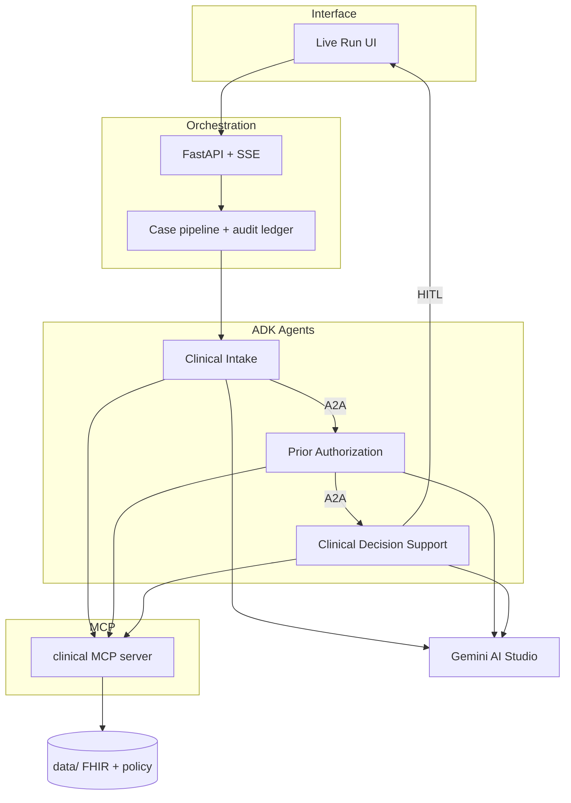

# AgentThree — Prior Authorization

One end-to-end prior authorization scenario (**CPT 72148 · MRI lumbar spine**) using **Google ADK**, **A2A**, **MCP**, and **Gemini**, connected to a Live Run UI.

**Repo:** [nickgulrajani/agentthree-prior-auth](https://github.com/nickgulrajani/agentthree-prior-auth)

> Fictional patients, payer, and policy — **not for clinical use**.

---

## Architecture



Full write-up: [`docs/architecture.md`](docs/architecture.md)

---

## Repository layout

```
agents/                  # Google ADK LlmAgents
  clinical_intake/
  prior_auth/
  clinical_decision_support/
mcp_servers/             # FastMCP tool servers
  clinical/              # FHIR · RxNorm · policy · eligibility · guidelines
agentthree/              # Orchestration backend (pipeline, API, audit, Gemini steps)
web/                     # React Live Run FE (Vite) — watch agents in play
ui/                      # Classic HTML Live Run
data/                    # Demo FHIR patients + AHP-RAD-014 policy
evaluation/              # Synthetic cases + metric scoring
tests/                   # Unit / smoke tests
docs/                    # Architecture and design notes
scripts/run_demo.sh
```

---

## Quick start (free tier)

No Workspace Gemini license required. Use a [Google AI Studio](https://aistudio.google.com/apikey) free API key.

```bash
python3 -m venv .venv
source .venv/bin/activate          # Windows: .venv\Scripts\activate
pip install -r requirements.txt
cp .env.example .env               # set GOOGLE_API_KEY; DEMO_MODE=false for live Gemini

# Terminal 1 — backend (MCP + API)
.venv/bin/python -m agentthree

# Terminal 2 — React FE (agents lighting up live)
cd web && npm install && npm run dev
```

Open **http://127.0.0.1:5173** — one UI with:

| Tab | What you show |
|-----|----------------|
| **Overview** | Architecture SVG (ADK · A2A · MCP · HITL · audit) |
| **Live run** | Agents lighting up + MCP / A2A inspector |
| **Engineering** | Capability cards |
| **Build status** | What’s built vs deferred |

Classic HTML remains at **http://127.0.0.1:8000/classic**.

Optional: `cd web && npm run build` then restart the backend so `/` serves the React bundle.

| Mode | Cost |
|------|------|
| Local MCP / API / UI | $0 |
| Gemini AI Studio Free tier | $0 within rate limits |
| `DEMO_MODE=true` | $0 (fixtures; MCP + A2A still real) |

Keep `GOOGLE_GENAI_USE_VERTEXAI=FALSE` to stay off Vertex billing.

---

## Scenario

Happy path: Jordan Rivera · CPT `72148` · ICD-10 `M54.16` · 6+ weeks PT · neurologic findings → recommend approval → human gate.

Fault injection: MCP timeout, eligibility outage, missing policy, grounding failure.

---

## Develop next

| Area | Folder | Next increments |
|------|--------|-----------------|
| Agents | `agents/` | Stronger structured output schemas; RemoteA2aAgent wiring |
| MCP | `mcp_servers/` | Split FHIR / policy / eligibility into separate servers |
| Evaluation | `evaluation/` | Expand golden cases; wire UI Evaluation tab to scored JSON |
| Tests | `tests/` | Pipeline + MCP contract tests; CI |
| Deploy | _(future)_ | Cloud Run / GKE — optional, not required for the demo |

```bash
# unit tests
.venv/bin/python -m pytest tests/ -q

# evaluation smoke
.venv/bin/python -m evaluation.run_eval
```
