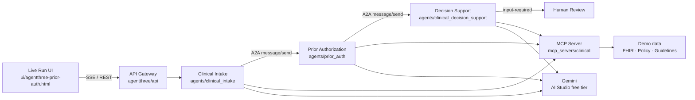

# Architecture

AgentThree coordinates three Google ADK agents over A2A-shaped handoffs, reaches clinical systems through MCP, and reasons with Gemini. A human reviewer always seals the case.

## Layers

| Layer | Path | Role |
|--------|------|------|
| Agents | `agents/` | ADK `LlmAgent`s with MCP toolsets |
| MCP | `mcp_servers/` | FastMCP tools: FHIR, RxNorm, policy, eligibility, guidelines |
| Orchestration | `agentthree/` | Case pipeline, Gemini steps, audit ledger, A2A envelopes |
| API + UI | `agentthree/api`, `ui/` | Live Run console + SSE |
| Evaluation | `evaluation/` | Synthetic cases and metric scoring |
| Tests | `tests/` | Unit / integration tests |

## Protocol notes

- **A2A** — Agent Cards via `to_a2a()` (optional ports 9001–9003); each case emits JSON-RPC `message/send` envelopes with a shared `contextId`.
- **MCP** — Streamable HTTP at `/mcp`; agents never query stores directly.
- **Safety** — Agents cannot deny; adverse paths escalate to a human. Audit events are SHA-256 hash-chained.
