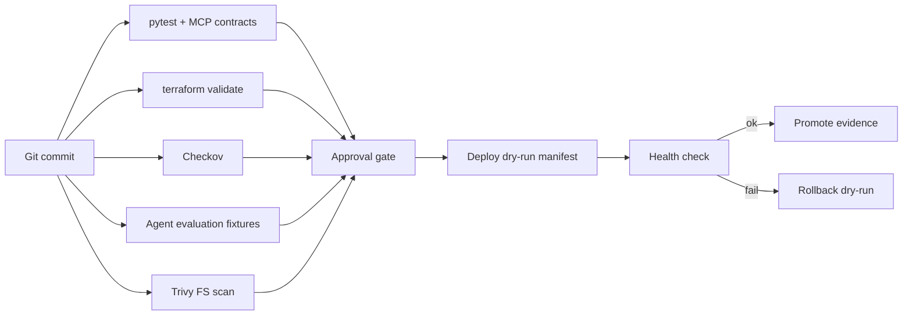

# Architecture (zero-billing)

## Boundaries

| In scope | Out of scope (avoids billing) |
|----------|-------------------------------|
| Validate / scan / test / gate | `terraform apply` |
| Local dry-run manifests | AKS / GKE / EKS / Cloud Run |
| Trivy filesystem scan | Pushing images to ACR/ECR/AR |
| Offline eval fixtures | Live LLM API calls in CI |
| Optional GitHub Environment reviewers | Paid Azure DevOps parallelism |

## Mapping to the simulator

| Simulator stage | This repo |
|-----------------|-----------|
| SAST / unit | `pytest` |
| Terraform / Checkov | `infra/*` + Checkov |
| Integration / MCP | `tests/test_mcp_contract.py` |
| Security / AI evaluation | `evaluation/fixtures/*` |
| PROD approval | `PROD_APPROVED` / Environment |
| Health / rollback | `rollback.py` |
