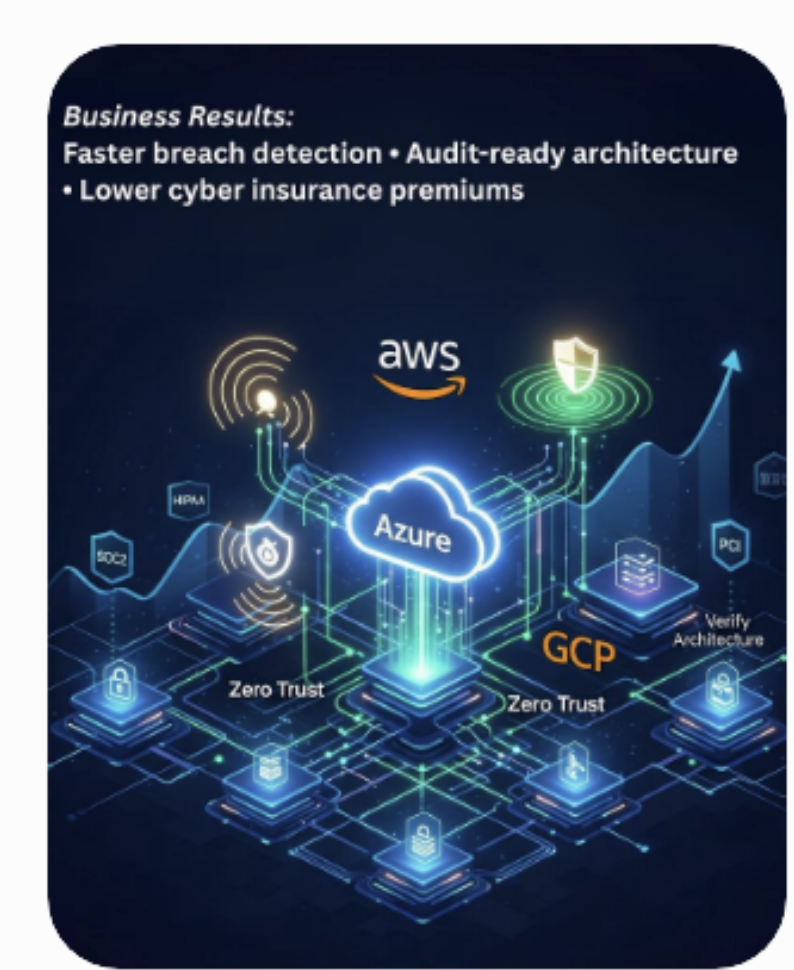
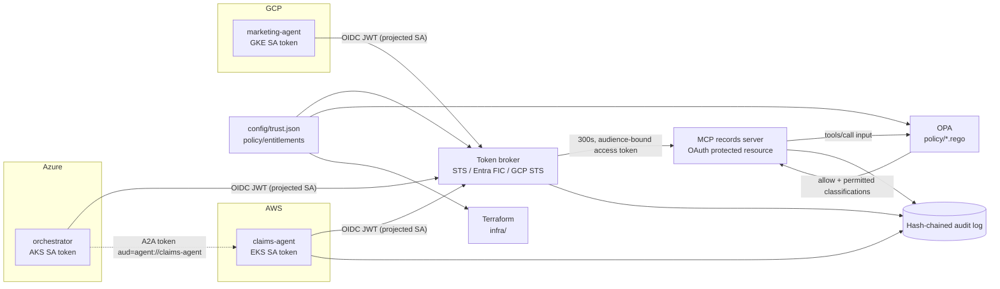

# AgentThree · Multi-Cloud Zero Trust for AI Agents

[](https://github.com/nickgulrajani/agentthree-multicloud-zero-trust/actions/workflows/zero-trust.yml)



A runnable security implementation for AI agents across AWS, Azure and GCP: workload identity, short-lived credentials, MCP authorization, agent-to-agent trust, policy-as-code, and allow/deny integration tests.

**$0 cloud spend.** The demo needs no cloud accounts, credentials or LLM API keys, and nothing is ever applied to a cloud.

**Business results:** faster breach detection · audit-ready architecture · lower cyber-insurance premiums

<br clear="right">

## What it demonstrates

> An authorized agent retrieves permitted records, while an unauthorized agent is denied and the denial is audited.

| # | Scenario | Result | Stopped by |
|---|----------|--------|------------|
| 1 | AWS `claims-agent` queries claims | **ALLOW**: 4 records; restricted `CLM-1004` withheld | OPA row-level filter |
| 2 | GCP `marketing-agent` queries claims | **DENY 403** + audit | OPA MCP policy |
| 3 | Azure `orchestrator` delegates to AWS `claims-agent` | **ALLOW** (cross-cloud A2A) | — |
| 4 | `marketing-agent` launders access through `claims-agent` | **DENY** | OPA A2A policy |
| 5 | Same as 4, but the callee is compromised and skips its check | **DENY 403** | MCP re-checks delegation chain |
| 6 | Forged token from an attacker-run OIDC issuer | **DENY** | Broker signature check |
| 7 | Token replayed after its 300 s TTL | **DENY 401** | Short-lived credential |
| — | Someone flips a `deny` to `allow` in the audit log | **Detected** | SHA-256 hash chain |

## Architecture



**One source of truth.** [config/trust.json](config/trust.json) and [policy/entitlements/data.json](policy/entitlements/data.json) are read by the Terraform (which provisions the cloud trust) and by the local runtime (which enforces it), so the demo enforces exactly what the IaC would deploy.

### How each piece maps to the real cloud service

| Control | Local (free) | AWS | Azure | GCP |
|---------|--------------|-----|-------|-----|
| Workload identity | RS256 OIDC issuer per cloud | EKS IRSA / OIDC provider | AKS workload identity + federated credential | GKE Workload Identity Federation |
| Short-lived credentials | Broker, RFC 8693 exchange, 300 s TTL | `AssumeRoleWithWebIdentity` (900 s) | Entra token exchange | STS + SA impersonation |
| Least privilege | OPA row-level filtering | `dynamodb:LeadingKeys` condition | RBAC role assignment | IAM binding to one `principal://` subject |
| MCP authorization | Bearer + RFC 9728 metadata + audience check + OPA | ← same code runs in any cloud → | | |
| Agent-to-agent trust | Audience-bound A2A token + delegation chain | | | |
| Policy-as-code | OPA / Rego + `opa test` | | | |
| Audit | Hash-chained JSONL | CloudTrail | Log Analytics / Sentinel | Cloud Audit Logs |

## Quick start

Prerequisites: Python 3.10+, OPA (`brew install opa`), and Terraform ≥ 1.7 (`brew install hashicorp/tap/terraform`), which is needed for mock-provider tests.

```bash
make setup        # venv + deps
make verify       # 15 Rego tests + 13 integration tests + terraform validate + 3 mock-provider tests
make demo         # narrated 7-scenario run → artifacts/evidence-report.html + audit.jsonl
make demo-step    # same, pauses between scenarios for live presenting
make serve        # real HTTP MCP server on :8765, prints curl commands with fresh tokens
```

## Layout

```
config/trust.json                 workload ↔ issuer ↔ subject ↔ scopes (shared by TF + runtime)
policy/mcp.rego, a2a.rego         deny-by-default authorization, row-level filtering, delegation rules
policy/entitlements/data.json     per-agent datasets, purposes, clearance, A2A allow-list
src/agentthree_zt/                issuers, broker, MCP server, agents, OPA client, audit, demo
infra/modules/{aws,azure,gcp}-workload-identity
infra/envs/demo                   root module + tests/zero_trust.tftest.hcl (mock providers)
tests/test_allow_deny.py          end-to-end allow/deny integration tests
```

## Why not LocalStack or real cloud?

- **Real accounts** risk surprise charges, such as KMS keys, Log Analytics ingestion and forgotten resources. They also need credentials during a live demo, and a network or quota failure can derail it.
- **Emulators** don't fit well: IAM policy enforcement in LocalStack is a paid feature, and neither Azure nor GCP has an IAM emulator, so you would still be simulating two of the three clouds.
- **This approach** runs the identity, policy and authorization code for real, keeps the IaC correct and tested with `terraform test` mock providers, and gives the same result on every run.

`terraform plan`/`apply` against real accounts is possible later (fill in the provider credentials), but the demo never needs it.
