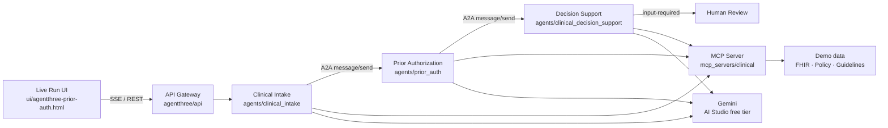

# Architecture

AgentThree coordinates three Google ADK agents over A2A-shaped handoffs, reaches clinical systems through MCP, and reasons with Gemini. A human reviewer always seals the case.

## Layers

| Layer | Path | Role |
|--------|------|------|
| Agents | `agents/` | ADK `LlmAgent`s with MCP toolsets |
| MCP | `mcp_servers/` | FastMCP tools: FHIR, RxNorm, policy, eligibility, guidelines |
| Orchestration | `agentthree/` | Case pipeline, Gemini steps, audit ledger, A2A envelopes |
| API + UI | `agentthree/api`, `ui/` | Live Run console + SSE |
| Evaluation | `evaluation/` | Synthetic cases and metric scoring |
| Tests | `tests/` | Unit / integration tests |

## Protocol notes

- **A2A** — Agent Cards via `to_a2a()` (`START_A2A=true`, ports 9001–9003). The case pipeline POSTs JSON-RPC `message/send` to the recipient’s A2A server; if the server is down it keeps a local task envelope for the UI. Shared `contextId` per case.
- **MCP** — Streamable HTTP at `/mcp`; agents never query stores directly. Resilience drills call the `set_fault` tool so failures come from the server (with real backoff sleeps), not scripted client errors.
- **Gemini** — Live path uses the async `google.genai` client (`client.aio.models.generate_content`). CDS grounding reports `claims` / `cited` / `unsupported`. The `grounding_fail` drill injects `UNCITED-DRILL-999` before the citation filter, blocks it, then regenerates without the inject.
- **HITL** — Agents cannot deny; adverse paths escalate to a human. Sealing a decision twice returns HTTP `409`. Audit events are SHA-256 hash-chained.
